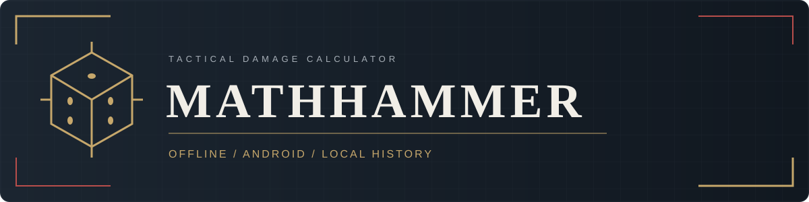

<p align="center">
  
</p>

<p align="center">
  <strong>Восемь характеристик. Две метрики. Никакой сети.</strong><br>
  Калькулятор среднего урона для Warhammer 40,000 с локальной историей расчётов.
</p>

| Платформа | Интерфейс | Хранилище | Лицензия |
|---|---|---|---|
| Android 8.0+ | Kotlin · Compose · Material 3 | Room · SQLite | [MIT](LICENSE) |

## Возможности

- Мгновенный расчёт потенциального урона после сейвов: **за один атакующий кубик** и **за все атаки**.
- Восемь полей: `A`, `BS/WS`, `S`, `AP`, `D`, `T`, `Sv`, `Inv`. Пояснения открываются по заголовку карточки.
- Именованные расчёты в истории: открыть, изменить, сохранить копию, переименовать, удалить и отменить удаление.
- Сохранение черновика при переключении экранов и повороте устройства; подтверждение перед его сбросом.
- Тёмный тактический интерфейс, встроенный **Exo 2**, адаптивная иконка и поддержка крупного системного текста.
- Полностью локальная работа без аккаунтов, рекламы, сетевых разрешений и облачной синхронизации.

## Контрольный залп

```text
Атакующий  A=12 · BS/WS=3+ · S=8 · AP=-2 · D=2
Защитник   T=5 · Sv=3+ · Inv=4+
```

| На одну атаку | Всего за 12 атак |
|:---:|:---:|
| **0,444** | **5,33** |

Одна атака — один кубик до проверки попадания. Промежуточные величины не округляются.
Учитывается один лучший сейв: броня с AP или Inv. При `A=0` общий урон равен нулю,
а гипотетический урон за одну атаку сохраняется.

Это упрощённая модель для одинаковых атак по однородной цели. Она не считает уничтоженные модели,
фактически снятые Wounds, избыточный урон, рероллы и особые способности.

## Сборка и установка

Нужны **JDK 21**, **Android SDK 35** и Android Studio. Gradle поставляется через Wrapper.

1. Откройте корень проекта в Android Studio.
2. В настройках Gradle выберите JDK 21 и дождитесь синхронизации зависимостей.
3. Соберите Debug APK или запустите `app` на подключённом телефоне.

Из PowerShell с настроенным `JAVA_HOME`:

```powershell
.\gradlew.bat testDebugUnitTest assembleDebug
adb install -r app/build/outputs/apk/debug/app-debug.apk
```

На Linux/macOS: `sh gradlew testDebugUnitTest assembleDebug`.
Первый запуск сборки скачивает зависимости; установленному приложению интернет не нужен.
JDK 25 не подходит закреплённой версии Gradle — используйте JDK 21.

| Вариант | Команда | Результат |
|---|---|---|
| Для своего телефона | `assembleDebug` | `app/build/outputs/apk/debug/app-debug.apk` |
| Для последующей подписи | `assembleRelease` | `app/build/outputs/apk/release/app-release-unsigned.apk` |

Unsigned APK нужно подписать перед установкой. Для локальной проверки достаточно Debug APK.

## История и приватность

Сохранение происходит **только по явному нажатию кнопки**. Название — от 1 до 80 Unicode-символов
после удаления пробелов по краям; одинаковые названия разрешены. История не имеет искусственного лимита.
«Сохранить изменения» обновляет выбранную запись, «Сохранить как новый» создаёт отдельную.

База находится в приватном каталоге приложения. Android backup и перенос данных отключены правилами приложения.
Экспорт и синхронизация не предусмотрены. **Удаление приложения удаляет его историю.**

## Документация

- [Техническое задание v2](docs/SPECIFICATION.md) — актуальные требования и формулы.
- [Дизайн](docs/DESIGN_GUIDE.md) и [исходные макеты](docs/design-kit/README.md).
- [Сборка и тестирование](docs/TESTING.md) — команды, структура проверок и работа со схемой БД.
- [Первоначальное ТЗ](docs/archive/SPECIFICATION_V1.md) — архив v1.
- [Сторонние ресурсы и лицензии](THIRD_PARTY_NOTICES.md).

Исходники приложения — `app/src/main`, JVM-тесты — `app/src/test`, Android-тесты — `app/src/androidTest`.
Экспортированные схемы Room хранятся в `app/schemas` и входят в репозиторий.
